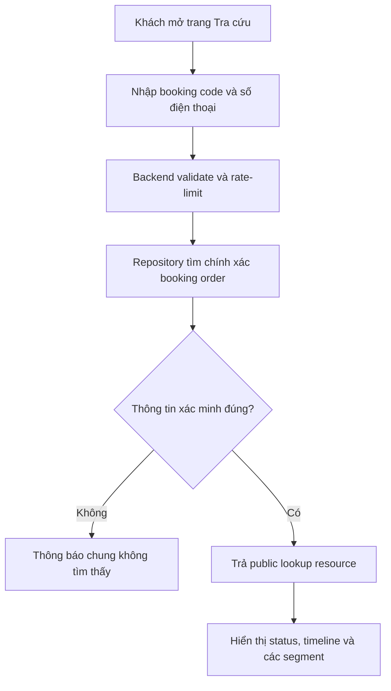

# Kế hoạch triển khai trang tra cứu trạng thái đơn hàng BALLBURN

- Ngày lập: 24/11/2026.
- Thiết kế tham chiếu: `docs/BALLBURN Order Status Check.png`.
- Phạm vi: trang tra cứu đơn công khai, liên kết Tra cứu trong header/footer và cập nhật nút Đặt sân ngay.
- Trạng thái: đã triển khai bản đầu ngày 24/11/2026; cần kiểm thử functional trên MySQL và visual QA trình duyệt trước production.

## 1. Mục tiêu

Khách có thể tra cứu trạng thái đơn đặt sân mà không cần đăng nhập, đồng thời không làm lộ thông tin cá nhân hoặc token bảo mật của đơn.

Trang mới cần:

- Cho phép khách nhập mã đơn và thông tin xác minh.
- Hiển thị trạng thái thanh toán, timeline và các khung sân trong đơn.
- Hỗ trợ đơn có nhiều sân hoặc nhiều khoảng giờ.
- Phân biệt rõ chờ thanh toán, đã thanh toán, hết hạn, đã hủy và cần đối soát.
- Dùng chung header/footer công khai và hệ thống semantic token hiện có.
- Giữ route status token hiện tại làm đường dẫn theo dõi ưu tiên sau checkout.

## 2. Đánh giá thiết kế tham chiếu

Các thành phần nên giữ:

- Hero nền sân pickleball với tiêu đề “Tra cứu trạng thái đơn hàng”.
- Form tra cứu nổi trong hero.
- Banner trạng thái có icon và màu sắc tương ứng.
- Timeline Đặt sân → Chờ thanh toán → Đã thanh toán.
- Card thông tin sân, ngày, khung giờ và tổng tiền.
- Khối lưu ý theo trạng thái.
- CTA “Đặt sân mới” và “Quay về trang chủ”.
- Header/footer đồng nhất với website công khai.

Điểm cần điều chỉnh:

- Không trả toàn bộ họ tên, điện thoại và email chỉ dựa trên booking code.
- Booking code `BB-YYYYMMDD-XXXXXX` không phải secret và có thể bị chia sẻ hoặc đoán.
- Thiết kế phải hỗ trợ nhiều booking segment thay vì giả định mỗi order chỉ có một sân.
- Timeline phải dùng timestamp thật từ database, không dùng thời gian trình bày giả.

## 3. Quyết định bảo mật

Form tra cứu sử dụng hai trường:

1. Mã đơn hàng.
2. Số điện thoại đã dùng khi đặt sân.

Không triển khai tra cứu chỉ bằng booking code nếu kết quả chứa thông tin lịch sân hoặc thông tin khách.

Khi lookup thất bại, trả thông báo chung:

> Không tìm thấy đơn hàng hoặc thông tin xác minh không chính xác.

Không tiết lộ booking code có tồn tại hay không. Endpoint phải rate-limit và trả `Cache-Control: no-store, private`.

Payload công khai không được chứa:

- `status_token_hash` hoặc status token.
- `hold_token_hash`.
- Đường dẫn ảnh chứng từ.
- Raw OCR, raw webhook hoặc provider metadata nội bộ.
- API key, transaction ID nội bộ và review note.
- Điện thoại hoặc email đầy đủ.

Tên, điện thoại và email chỉ hiển thị dạng che một phần nếu giao diện thực sự cần.

## 4. Luồng mục tiêu



Route status token hiện tại vẫn giữ nguyên:

```text
/booking/status/{token}
```

Đây vẫn là đường dẫn theo dõi ưu tiên được trả về ngay sau checkout.

## 5. Trạng thái hiển thị

| Trạng thái dữ liệu | Nhãn giao diện | Hành vi |
| --- | --- | --- |
| `PENDING_PAYMENT`, deadline còn hạn | Chờ thanh toán | Hiển thị deadline và hướng dẫn hoàn tất chuyển khoản |
| `PENDING_PAYMENT`, `now >= deadline` | Đã hết hạn | Không thêm enum DB; trạng thái được suy ra khi đọc |
| `PAID` | Đã thanh toán | Hiển thị xác nhận giữ sân thành công |
| `CANCELLED` | Đã hủy | Hiển thị hướng dẫn liên hệ nếu đã chuyển tiền |
| Có đối soát cần xử lý | Cần hỗ trợ đối soát | Không tuyên bố đã thanh toán; hướng dẫn liên hệ BALLBURN |

## 6. Backend

### 6.1. Routes

Thêm vào `routes/web.php`:

```text
GET  /booking/lookup
POST /booking/lookup
```

- `GET` render public page với SEO phù hợp.
- `POST` trả JSON lookup.
- `POST` dùng rate limit riêng, dự kiến 10 request/phút/IP.
- Cả page và response lookup dùng `no-store, private`.
- Không tắt CSRF cho endpoint này.

### 6.2. Form Request

Tạo:

```text
app/Http/Requests/Booking/LookupGuestBookingRequest.php
```

Validation:

- `booking_code`: bắt buộc, uppercase/normalize và đúng dạng `BB-YYYYMMDD-XXXXXX`.
- `customer_phone`: bắt buộc, giới hạn độ dài và normalize khoảng trắng/ký tự phân cách.
- Không dùng query mơ hồ hoặc tìm gần đúng.

### 6.3. Controller

Bổ sung controller riêng hoặc action rõ ràng trong khu vực booking công khai:

```text
app/Http/Controllers/Booking/GuestBookingLookupController.php
```

Controller chỉ:

- Nhận dữ liệu đã validate.
- Gọi service.
- Trả resource công khai hoặc lỗi lookup chung.
- Gắn cache headers phù hợp.

### 6.4. Service và repository

Bổ sung contract trong `BookingRepository`:

```php
public function findGuestOrderForLookup(
    string $bookingCode,
    string $normalizedPhone,
): ?BookingOrder;
```

Repository cần:

- Lookup chính xác theo indexed unique `booking_orders.booking_code`.
- So sánh số điện thoại đã normalize.
- Eager-load `bookings.court`, payment summary và status history cần dùng.
- Không lookup trong JSON hoặc nội dung webhook.
- Không tạo side effect khi tra cứu.

### 6.5. Public resource

Tạo:

```text
app/Http/Resources/GuestBookingLookupResource.php
```

Payload dự kiến:

```json
{
  "booking_code": "BB-20261125-5CRX4G",
  "status": "PAID",
  "status_label": "Đã thanh toán",
  "created_at": "2026-11-25T06:58:00+07:00",
  "payment_deadline_at": "2026-11-25T07:03:00+07:00",
  "paid_at": "2026-11-25T07:02:00+07:00",
  "total_amount": "250000.00",
  "currency": "VND",
  "customer": {
    "name": "Nguyễn V*** A",
    "phone": "******8614",
    "email": "n***@gmail.com"
  },
  "bookings": []
}
```

### 6.6. Timeline

Nguồn thời gian:

- Đặt sân: `booking_orders.created_at`.
- Chờ thanh toán: status history đầu tiên hoặc thời điểm tạo order.
- Đã thanh toán: `booking_orders.paid_at`.
- Đã hủy: status history có `new_status=CANCELLED`.
- Hết hạn: `payment_deadline_at`, chỉ là trạng thái suy ra.

Không tạo timeline giả nếu timestamp không tồn tại.

## 7. Frontend

### 7.1. Page mới

Tạo:

```text
src/pages/BookingLookupPage.vue
```

Các UI state:

- Chưa tra cứu.
- Đang gửi request.
- Validation error.
- Không tìm thấy hoặc xác minh sai.
- Chờ thanh toán.
- Đã thanh toán.
- Hết hạn.
- Đã hủy.
- Cần hỗ trợ đối soát.

### 7.2. Router

Bổ sung vào `src/router/index.js`:

```js
{
    path: 'booking/lookup',
    name: 'booking-lookup',
    component: BookingLookupPage,
}
```

### 7.3. Cấu trúc trang

1. Hero tra cứu.
2. Form booking code + số điện thoại.
3. Status banner.
4. Timeline responsive.
5. Danh sách booking segment.
6. Thông tin người đặt đã mask.
7. Khối lưu ý theo trạng thái.
8. CTA “Đặt sân mới” và “Quay về trang chủ”.

Đối với đơn nhiều sân, render từng segment riêng:

```text
Sân 1 — 07:00–08:00
Sân 3 — 08:30–09:30
```

Không gộp sai các khung giờ không liền nhau.

### 7.4. Responsive và accessibility

- Desktop: input và nút tra cứu trên cùng một hàng.
- Mobile: form xếp dọc, nút rộng toàn phần.
- Timeline desktop nằm ngang, mobile chuyển dọc.
- Card segment từ bốn cột chuyển thành một hoặc hai cột.
- Có label thật cho input, không chỉ placeholder.
- Loading dùng `aria-live`; lỗi dùng `role=alert`.
- Status không chỉ phân biệt bằng màu.
- Focus ring rõ ràng và hỗ trợ bàn phím.

## 8. Header và footer

Sửa:

- `src/components/layout/AppHeader.vue`.
- `src/components/layout/AppFooter.vue`.
- `resources/js/pages/Home.vue` vì homepage Inertia có header/footer riêng.

Thêm link:

```text
Tra cứu → /booking/lookup
```

Thứ tự đề xuất trong header:

```text
Trang chủ
Về chúng tôi
Đặt sân
Tra cứu
Tin tức
Liên hệ
```

Footer thêm “Tra cứu” ngay sau “Đặt sân”. Menu mobile phải tự đóng sau khi chọn link.

## 9. Nút “Đặt sân ngay”

Thiết kế tham chiếu dùng:

- Viền cam.
- Nền trắng hoặc trong suốt.
- Chữ cam.
- Icon lịch bên trái.
- Bo tròn dạng pill.
- Label “Đặt sân ngay”.

Bổ sung variant riêng trong `src/components/ui/BaseButton.vue` và `src/assets/styles/global.css`:

```text
.button--booking
```

Ví dụ sử dụng:

```vue
<BaseButton to="/booking" variant="booking" size="small">
    <CalendarIcon aria-hidden="true" />
    Đặt sân ngay
</BaseButton>
```

Không thay đổi toàn bộ `.button--primary`, vì các CTA khác vẫn cần style hiện tại.

Trạng thái hover/focus:

- Hover: nền cam, chữ trắng.
- Focus-visible: ring tương phản rõ ràng.
- Icon dùng `currentColor`.
- Không tạo hiệu ứng chuyển động mạnh khi người dùng bật reduced motion.

## 10. SEO và cache

Trang GET cần metadata:

- Title: `Tra cứu đơn hàng | BALLBURN PickleClub & Bistro`.
- Description mô tả việc kiểm tra trạng thái đặt sân và thanh toán.
- Canonical: `/booking/lookup`.
- Có thể dùng `noindex,follow` nếu không muốn trang tiện ích xuất hiện trong kết quả tìm kiếm.

Kết quả lookup không được cache tại browser/CDN:

```http
Cache-Control: no-store, private
```

Cloudflare phải bypass cache cho POST lookup và mọi URL status có token.

## 11. Kiểm thử

### Backend

- Booking code và phone đúng.
- Booking code đúng nhưng phone sai.
- Booking code không tồn tại.
- Normalize booking code và số điện thoại.
- Validation format và độ dài.
- Rate limit.
- Không lộ token/contact đầy đủ/proof/raw webhook.
- `PENDING_PAYMENT` trước deadline.
- Chính xác tại deadline được xem là hết hạn.
- `PAID`, `CANCELLED`, `EXPIRED` suy ra và `NEEDS_REVIEW`.
- Đơn nhiều sân và nhiều range.
- Response có `no-store, private`.

### Frontend

- Empty/loading/error/success state.
- Timeline đúng theo từng trạng thái.
- Đơn nhiều segment hiển thị đúng.
- Responsive desktop/tablet/mobile.
- Header/footer có link Tra cứu ở cả Vue Router app và homepage Inertia.
- Nút “Đặt sân ngay” đúng design, hover và keyboard focus.
- Không hiển thị dữ liệu nhạy cảm trong DOM hoặc error message.

### Validation workflow

- Chạy feature/unit tests liên quan.
- Chạy MySQL 8.4 functional test cho query thực tế.
- Chạy `npm run types:check`.
- Chạy `WAYFINDER_SKIP_GENERATION=true npm run build`.
- Chạy Pint cho PHP thay đổi.
- Kiểm tra trực quan ở các breakpoint chính.

## 12. Thứ tự triển khai

1. Chốt lookup bằng booking code + số điện thoại.
2. Tạo Form Request, repository query, service và public resource.
3. Tạo GET/POST routes và controller.
4. Viết feature tests bảo mật trước khi dựng UI.
5. Tạo `BookingLookupPage.vue` theo thiết kế tham chiếu.
6. Thêm route Vue Router.
7. Cập nhật header/footer của cả hai public frontend.
8. Thêm variant và icon cho nút “Đặt sân ngay”.
9. Chạy type-check, build, Pint và test.
10. Kiểm tra responsive/accessibility và cập nhật `AGENTS.md` khi hành vi đã được triển khai thực tế.

## 13. Tiêu chí nghiệm thu

- Khách tra cứu được đơn hợp lệ bằng booking code và số điện thoại.
- Không thể dùng booking code đơn lẻ để lấy dữ liệu cá nhân hoặc lịch sân.
- Trạng thái và timeline khớp dữ liệu order hiện tại.
- Đơn nhiều sân hiển thị đầy đủ, không mất segment.
- Header/footer có link Tra cứu trên desktop và mobile.
- Nút “Đặt sân ngay” khớp thiết kế và không phá các CTA khác.
- Response lookup không cache và không lộ dữ liệu nội bộ.
- Các test trọng yếu đạt trên MySQL trước khi deploy production.
