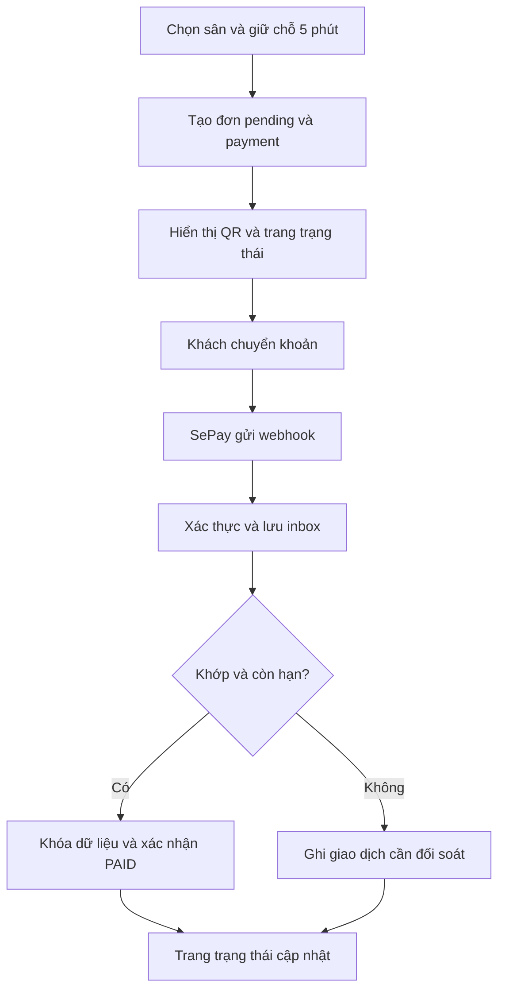

# Kế hoạch tích hợp SePay xác nhận thanh toán đặt sân BALLBURN

- Ngày lập: 20/11/2026.
- Repository: [TooDo1508/ball-burn](https://github.com/TooDo1508/ball-burn).
- Mốc khảo sát: `main@82b5128774f2062c7651a022612b76ab730517f3`.
- Trạng thái: thiết kế đề xuất; tài liệu này không triển khai code hoặc cấu hình production.
- Mục tiêu: khách tạo đơn, quét QR và chuyển khoản; backend xác nhận tiền qua SePay rồi tự chuyển toàn bộ đơn sang `PAID`.

## 1. Hiện trạng đã kiểm tra trong source

| Thành phần | Hành vi hiện tại | Thay đổi cần làm |
| --- | --- | --- |
| `/booking/holds` | Giữ chỗ 5 phút; sinh mã `BBPAY` + 10 ký tự; hash token; đồng bộ không gia hạn | Giữ thời hạn gốc; bảo đảm mã thanh toán duy nhất trên đơn |
| `/booking/payment-instructions` | Kiểm tra holds, tính giá và trả QR; **chưa tạo đơn** | Tạo đơn và payment trước khi trả QR trong chế độ SePay |
| `/booking/payment-proof` | Upload ảnh mới tạo order, segments, payment và receipt | Chế độ SePay chỉ đính kèm ảnh vào đơn đã có; ảnh là tùy chọn |
| `GuestBookingOrderResource` | Trả trạng thái đơn, hạn thanh toán, thông tin khung sân | Bổ sung trạng thái hiển thị hết hạn và kết quả đối soát an toàn |
| `VietQrImageUrlService` | Sinh VietQR VPBank với số tiền và `addInfo` | Có thể giữ nhà cung cấp ảnh QR hiện tại |
| `PaymentReceiptMappingService` | OCR chỉ đối chiếu nội dung; không đánh dấu đã trả tiền | Tiếp tục là công cụ hỗ trợ admin |
| `booking_orders.status` | Nguồn trạng thái chính: `PENDING_PAYMENT / PAID / CANCELLED` | Không tạo thêm nguồn trạng thái đơn trong segments/payment |
| `payment_webhook_events` | Migration đã tạo bảng và UNIQUE(provider, provider_event_id), chưa có luồng tích hợp | Tái sử dụng làm inbox bền vững |
| `bank_transfer_transactions` | Có mã giao dịch unique, liên kết payment/booking tùy chọn | Ghi nhận cả giao dịch khớp và cần đối soát |
| Admin đổi trạng thái | Có khóa court/order nhưng chưa kiểm tra xung đột khi xác nhận đơn pending cũ | Dùng chung quy tắc xác nhận an toàn cho webhook, admin đơn lẻ và bulk |
| `routes/console.php` | Chưa đăng ký lịch dọn hết hạn hay xử lý lại thanh toán | Thêm scheduler phục hồi inbox; không phụ thuộc cleanup để nhả sân |

Các file trọng tâm:

- `app/Services/Booking/GuestBookingService.php`
- `app/Repositories/Eloquent/EloquentBookingRepository.php`
- `app/Http/Controllers/Booking/GuestBookingController.php`
- `src/pages/BookingPage.vue`
- `app/Repositories/Eloquent/EloquentAdminBookingRepository.php`
- `database/migrations/2026_11_02_000002_create_pickleball_booking_tables.php`
- `database/migrations/2026_11_08_000001_remove_legacy_booking_workflow_columns.php`

**Điểm bắt buộc:** nếu chỉ thêm webhook vào luồng cũ, khách chuyển tiền trước khi upload ảnh thì chưa có order/payment để khớp. Vì vậy đổi thời điểm tạo đơn là phần bắt buộc của tích hợp.

## 2. Phương án triển khai

### 2.1. Phạm vi MVP

1. Một tài khoản nhận tiền VPBank đã liên kết SePay.
2. QR chuyển khoản chứa mã thanh toán riêng cho một đơn gồm nhiều sân/khung giờ.
3. SePay Bank Transaction Webhook gửi về backend; không cần tích hợp Payment Gateway checkout hay Bank Hub.
4. Xác thực API Key qua HTTPS cho MVP; không dùng endpoint không xác thực. HMAC là nâng cấp riêng nếu cần.
5. Xử lý nghiệp vụ ngắn, đồng bộ sau khi lưu inbox; không bắt buộc Redis queue worker.
6. Scheduler xử lý lại sự kiện đã lưu nhưng chưa hoàn tất; email/OCR không nằm trên đường xác nhận chính.
7. Giữ quy tắc giữ sân 5 phút và giá tính tại server; không tự gia hạn khi khách xem QR, reload hoặc gửi ảnh.

SePay thông báo biến động tài khoản đã liên kết. Việc chỉ tạo ảnh QR không cung cấp bằng chứng tiền vào. QR hiện tại có thể tiếp tục sử dụng nếu đúng tài khoản, số tiền và nội dung.

### 2.2. Chuẩn bị tài khoản

- Chủ tài khoản tự đăng ký/đăng nhập SePay và liên kết ngân hàng, thực hiện bước xác thực của ngân hàng.
- Xác định tài khoản VPBank là cá nhân hay hộ kinh doanh. Theo hướng dẫn hiện tại, hộ kinh doanh có trường hợp chỉ đồng bộ qua VA; cần chọn đúng tài khoản nhận và sửa cấu hình QR tương ứng trước khi bật.
- MVP ưu tiên tài khoản cá nhân được đồng bộ tiền vào tài khoản chính. Nếu bắt buộc dùng VA, phải kiểm tra payload thật và cách đối chiếu `accountNumber/subAccount`; không mặc định VA giống số tài khoản chính.
- Xác nhận gói dịch vụ, hạn mức và điều kiện đồng bộ đang áp dụng trong tài khoản; không giả định miễn phí hoặc cam kết thời gian nhận tiền.
- Dùng kết nối ngân hàng hỗ trợ transaction webhook; không chọn luồng chỉ có QR tĩnh NAPAS.
- Không đưa mật khẩu ngân hàng, OTP, secret hoặc số tài khoản thật vào Git.

Nguồn: [VPBank](https://docs.sepay.vn/ket-noi-vpbank.html), [phạm vi webhook](https://docs.sepay.vn/tich-hop-webhooks.html).

## 3. Luồng mục tiêu



### 3.1. Tạo đơn trước QR

Trong chế độ SePay, thay hành vi `POST /booking/payment-instructions`:

1. Validate thông tin khách, status token, hold token, slots bằng Form Request.
2. Tính lại giá từ server; không nhận tổng tiền do frontend quyết định.
3. Trong transaction, khóa court theo ID tăng dần; kiểm tra holds, giờ mở cửa, closures và lịch đang chiếm.
4. Tạo order `PENDING_PAYMENT`, các booking segments và **một payment cho toàn bộ tổng đơn**, gắn primary segment như cấu trúc hiện tại.
5. Sao chép `payment_reference` và deadline từ holds sang dữ liệu bền vững của order/payment; lưu snapshot tài khoản nhận.
6. Xóa holds đã chuyển thành booking trong cùng transaction. Pending booking tiếp tục giữ lịch đến deadline.
7. Commit rồi trả QR, booking code, payment reference, deadline, status URL. Chỉ hiển thị QR sau khi tạo đơn thành công.
8. Retry cùng token và cùng nội dung trả lại đúng đơn; reuse token với dữ liệu khác bị từ chối. Hai request song song phải tạo đúng một đơn.

Một lần checkout đã chốt giá và slots. Khi khách quay lại đổi sân, bắt đầu checkout mới; không sửa giá/slots/mã của đơn đã phát QR. Đơn cũ hết hạn theo deadline, hoặc được hủy theo nghiệp vụ riêng có kiểm tra thanh toán.

### 3.2. Xem kết quả

- Dùng lại `GET /booking/status/{token}/data`, hash token trong DB; token không dùng làm mã chuyển khoản.
- Frontend hỏi **Ballburn** mỗi 3–5 giây khi đang chờ; không gọi SePay từ trình duyệt.
- Hiển thị rõ: “Chờ thanh toán”, “Đã thanh toán”, “Hết thời gian giữ sân”, “Cần hỗ trợ đối soát”, “Đơn đã hủy”.
- Dừng polling khi PAID/CANCELLED hoặc hết hạn; cho phép kiểm tra lại khi có hỗ trợ đối soát.
- UI hết giờ phải đọc lại server trước khi kết luận; không đổi database dựa vào timer trình duyệt.
- Giữ `Cache-Control: no-store, private` và bypass CDN cache cho trang/API trạng thái, checkout và webhook.

## 4. Mã thanh toán và số tiền

- Giữ định dạng hiện tại: `BBPAY[A-Z0-9]{10}`, ví dụ `BBPAY7X2M9A4K6Q`.
- Đây là payment reference, khác booking code `BB-YYYYMMDD-XXXXXX`.
- Cấu hình nhận diện mã trên SePay: tiền tố `BBPAY`, hậu tố đúng 10 ký tự, loại số và chữ.
- Ưu tiên `code`; nếu rỗng thì parse `content` theo mẫu có ranh giới ký tự. Nhiều mã hoặc `code/content` mâu thuẫn phải review.
- Không xóa toàn bộ dấu cách/ký tự rồi khớp một phần tùy ý, không đoán theo tên/số điện thoại.
- Lookup mã bằng cột có UNIQUE/index; không tìm mơ hồ trong JSON hay toàn bộ mô tả.
- Snapshot số tiền, tiền tệ, bank/account/subaccount tại checkout; thay tài khoản trong settings không được thay tiêu chuẩn khớp của QR cũ.
- Chỉ xử lý VND, số tiền dương, không dùng float. Chuyển `transferAmount=200000` thành decimal chuẩn `200000.00` trước khi so với order/payment.
- MVP yêu cầu một giao dịch đúng toàn bộ tổng đơn. Chuyển thiếu, thừa hoặc nhiều lần không tự cộng gộp.

Nguồn cấu hình mã: [SePay payment code](https://developer.sepay.vn/vi/sepay-webhooks/cau-hinh-ma-thanh-toan).

## 5. Thiết kế dữ liệu

Chỉ thêm migration mới; không sửa lịch sử migration hoặc import SQL export.

| Bảng | Đề xuất |
| --- | --- |
| `booking_orders` | Thêm `payment_reference VARCHAR(32) NULL UNIQUE`; đơn mới SePay bắt buộc có reference ở tầng nghiệp vụ |
| `payments` | Dùng `provider=SEPAY`, `payment_method=BANK_TRANSFER`; giữ `qr_payload` tương thích; `provider_metadata` chứa snapshot tài khoản nhận; khi xác nhận lưu `provider_transaction_id`, `paid_at` |
| `payment_webhook_events` | Giữ UNIQUE hiện có; provider phân biệt live/test; thêm `payload_hash`, `attempts`, `next_attempt_at`, `processing_started_at`, `outcome`, FK nullable tới order/payment/bank transaction |
| `bank_transfer_transactions` | Giữ UNIQUE(bank_transaction_id); thêm nullable provider, provider_transaction_id, bank_reference_code và snapshot receiver khi cần; mã nội bộ `SEPAY:LIVE:{id}` |
| `booking_status_history` | Mỗi segment ghi chuyển trạng thái với `change_source=PAYMENT_WEBHOOK`; dùng enum có sẵn |
| `notifications/audit_logs` | Ghi xác nhận hoặc yêu cầu đối soát một lần, khóa idempotency theo transaction/order |

Quy tắc schema:

- Tái sử dụng inbox đã có, không tạo bảng webhook thứ hai.
- `booking_orders.status` tiếp tục là trạng thái đơn; không thêm lại `payments.status` đã bị bỏ.
- UNIQUE(provider, provider_transaction_id) ở payments bảo vệ giao dịch được áp dụng một lần; UNIQUE inbox bảo vệ nhận sự kiện.
- Một provider event có thể xử lý lại nhiều lần; chỉ một bản ghi tiền thực nhận cho một giao dịch.
- FK tới chứng từ tài chính dùng RESTRICT khi xóa; bổ sung chặn xóa đơn có giao dịch/webhook liên quan. Không dùng CASCADE xóa mất lịch sử tiền.
- Trước backfill reference cũ từ `qr_payload`, báo cáo mã trùng/không hợp lệ; không tự chọn một order khi có nhiều ứng viên.
- Dùng namespace test riêng trong môi trường staging. Không cho test event xác nhận đơn production.
- Giới hạn `DECIMAL(10,2)` hiện tại phải được validate; payload vượt miền lưu trữ được lưu inbox và báo lỗi/review, không bị cắt số.

Trạng thái inbox giữ enum có sẵn: RECEIVED, PROCESSING, PROCESSED, FAILED, IGNORED. Kết quả nghiệp vụ đặt ở `outcome`: APPLIED, NEEDS_REVIEW, UNMATCHED, ALREADY_PAID. Một event PROCESSED có thể cần admin review; không đồng nghĩa đơn PAID.

## 6. Webhook contract

### 6.1. Endpoint và xác thực

- Đề xuất: `POST https://ballburn.site/api/webhooks/sepay`.
- Đăng ký path đầy đủ `/api/webhooks/sepay` trong `routes/api.php`: repo đang đặt `apiPrefix: ''`.
- API route dùng xác thực riêng, không yêu cầu session/login/CSRF; không tắt CSRF toàn website.
- Chọn JSON và API Key trên SePay. Kiểm tra header `Authorization: Apikey <secret>` bằng `hash_equals`; thiếu cấu hình hoặc sai key thì fail closed.
- Secret chỉ đọc qua config/env server; không có tiền tố VITE, không log header hoặc trả secret về frontend.
- HMAC có thể bổ sung theo hướng dẫn chính thức; nếu dùng phải kiểm tra raw body và quy tắc timestamp/retry thực tế, không tự đặt format chữ ký.
- Rate limit riêng đủ nhận burst/retry; lỗi phải JSON, không redirect hoặc trả trang HTML.

Nguồn xác thực: [SePay authentication](https://developer.sepay.vn/vi/sepay-webhooks/xac-thuc).

### 6.2. Dữ liệu cần dùng

| Trường SePay | Vai trò |
| --- | --- |
| `id` | ID ổn định để chống xử lý trùng webhook |
| `transferType` | Chỉ chấp nhận tiền vào `in` để xác nhận |
| `gateway, accountNumber, subAccount` | Đối chiếu tài khoản nhận |
| `code, content` | Tìm payment reference |
| `transferAmount` | So tiền với tổng order/payment |
| `transactionDate` | Thời điểm ngân hàng theo giờ Việt Nam; parse Asia/Ho_Chi_Minh rồi lưu UTC |
| `referenceCode` | Mã tham chiếu ngân hàng hỗ trợ đối soát, không thay tùy tiện cho webhook id |

Validate độ dài, kiểu, phạm vi tiền, ngày hợp lệ. Lưu `received_at` riêng để đo độ trễ; không dùng `accumulated` làm số tiền giao dịch.

Nguồn payload: [SePay integration](https://developer.sepay.vn/vi/sepay-webhooks/tich-hop-webhook).

### 6.3. Nhận và phản hồi

1. Xác thực trước khi ghi dữ liệu tài chính.
2. Validate envelope, tính hash payload; insert inbox rồi commit.
3. Nếu trùng ID, đọc event hiện có: terminal thì ACK; RECEIVED/FAILED thì tiếp tục xử lý hoặc để scheduler phục hồi. Không return chỉ vì “đã tồn tại” khi lần trước chưa hoàn tất.
4. Cùng ID nhưng dữ liệu tài chính khác: không ghi đè payload gốc, ghi anomaly và cảnh báo.
5. Gọi xử lý nghiệp vụ ngắn, không OCR/SMTP/API ngoài.
6. Trả `200 {"success":true}` khi sự kiện đã xử lý hoặc đã lưu bền vững với đường phục hồi hoạt động.

| Tình huống | HTTP/kết quả |
| --- | --- |
| Sai/thiếu API Key | 401; không thay đổi đơn |
| JSON/schema sai | 400/422; log lỗi đã che dữ liệu nhạy cảm |
| Đã xử lý, duplicate hợp lệ, hoặc nghiệp vụ cần review đã được lưu | 200 + success true |
| DB lỗi, không lưu được inbox | 503 + success false |
| Xử lý lỗi sau khi inbox đã commit | Mark FAILED; mặc định trả 500 để provider retry và scheduler cùng có thể phục hồi |
| Event đang được xử lý nơi khác | ACK sau khi xác nhận event bền vững và lease/recovery đã hoạt động |

Bật gửi lại khi HTTP ngoài 2xx trong SePay. Không dựa vào retry vô hạn; SePay có lịch retry hữu hạn và có phát lại thủ công. Đặt mục tiêu phản hồi p95 dưới 1 giây; số này là mục tiêu triển khai Ballburn.

Nguồn ACK/retry: [Webhook guide](https://docs.sepay.vn/tich-hop-webhooks.html), [xử lý lỗi](https://developer.sepay.vn/vi/sepay-webhooks/xu-ly-loi).

## 7. Transaction xác nhận và chống đặt trùng

Dùng cùng một service xác nhận cho webhook và các đường admin liên quan; các query nằm trong repository.

1. Resolve ứng viên bằng mã chính xác; nếu không có hoặc nhiều ứng viên thì lưu outcome cần review.
2. Đọc snapshot court IDs của toàn đơn; khóa **court tăng dần → order → segments/payment → bank transaction → event**. Các luồng tạo đơn, giữ sân, admin đơn lẻ/bulk, closure và xử lý lại tuân thủ thứ tự tương thích.
3. Đọc lại dữ liệu sau khi khóa. Thử khóa event ở bước cuối và kiểm tra đã terminal chưa; nếu terminal, không áp dụng lần hai.
4. Kiểm tra provider, recipient snapshot, tiền/currency, trạng thái đơn, deadline và eligibility.
5. Kiểm tra overlap cho **tất cả segments**, loại chính order hiện tại; kiểm tra order khác đang chiếm lịch, holds còn hạn của khách khác và closures.
6. Ghi bank transaction unique; nếu đã tồn tại, chỉ tái sử dụng khi các dữ liệu bất biến khớp.
7. Nếu đủ điều kiện: order PAID, order/payment paid_at, provider_transaction_id, bank transaction MATCHED, lịch sử mỗi segment và notification/audit cùng commit.
8. Nếu không đủ: lưu tiền thực nhận và lý do review; không đổi lịch hoặc paid_at của order.
9. Cập nhật event outcome/processed_at trong cùng transaction nghiệp vụ. Rollback phải để event có thể xử lý lại.
10. Sau commit mới gửi tác vụ phụ. Không gửi email hay gọi SePay trong khi giữ khóa.

Vì dữ liệu lịch dùng UTC, thời điểm quyết định `now` phải lấy **sau khi chờ khóa**. Không dùng thời gian cũ trước transaction để “còn hạn” giả.

MVP không tự hạ PAID về PENDING_PAYMENT khi payment đã có chứng từ SePay. Điều chỉnh tài chính, hủy và hoàn tiền cần thao tác riêng có quyền và audit. Admin bulk cũng phải kiểm tra xung đột giữa chính các đơn trong batch, không chỉ với dữ liệu bên ngoài.

## 8. Chính sách các tình huống ngoại lệ

| Tình huống | Tự xác nhận? | Cách xử lý |
| --- | --- | --- |
| Đúng mã, đúng tiền, đúng receiver, đơn pending còn hạn, lịch không xung đột | Có | PAID cho toàn bộ order |
| Giao dịch tiền ra | Không | IGNORED, không thay đổi đơn |
| Sai tài khoản/bank/VA | Không | NEEDS_REVIEW và cảnh báo cấu hình |
| Thiếu mã, mã lạ hoặc nhiều mã | Không | UNMATCHED; admin tìm giao dịch |
| Thiếu/thừa tiền | Không | NEEDS_REVIEW; không tự cộng nhiều giao dịch |
| Webhook gửi trùng cùng id | Không áp dụng lại | ACK, giữ nguyên history/notification |
| ID mới nhưng cùng đơn đã PAID | Không áp dụng lại | Ghi giao dịch mới để review khoản chuyển thêm |
| Đơn CANCELLED | Không | Giữ hủy; review/hoàn tiền thủ công |
| Tiền tới sau deadline | Không | Ghi late payment; không chiếm lại sân |
| Tiền có timestamp trước deadline nhưng webhook xử lý sau deadline | Không trong MVP | Review vì lịch có thể đã nhả; không tự phục hồi quyền giữ sân |
| Đã có người khác giữ/đặt hoặc closure mới | Không | Ghi xung đột; bảo vệ lịch hiện tại |
| Khách tắt trình duyệt sau chuyển khoản | Có nếu vẫn đủ điều kiện | Backend độc lập frontend; xem lại status URL |
| Upload ảnh/OCR MATCHED | Không | Chỉ là chứng từ hỗ trợ |
| Webhook và admin xác nhận cùng lúc | Một chuyển trạng thái | Khóa chung, đọc lại PAID, phân loại giao dịch đến sau |

Quy tắc MVP là bảo thủ: `now >= payment_deadline_at` đã hết hạn. Khách cần được báo rõ hết thời gian giữ sân và cách liên hệ khi đã chuyển tiền.

Giữ trạng thái DB PENDING_PAYMENT cho đơn chưa trả nhưng quá hạn, hiển thị trạng thái suy ra EXPIRED. Không thêm enum EXPIRED hoặc tự đổi CANCELLED trong MVP. Availability đã bỏ qua pending quá hạn; scheduler không phải điều kiện để nhả sân.

## 9. Phân chia code dự kiến

Các tên file mới dưới đây là đề xuất, chưa tồn tại:

| File/nhóm | Công việc |
| --- | --- |
| `config/sepay.php`, `.env.example` | Feature flags và secrets dạng placeholder |
| `app/Http/Controllers/Payments/SePayWebhookController.php` | Nhận request và trả JSON |
| `app/Http/Middleware/VerifySePayWebhook.php` | API Key, fail closed |
| `app/Http/Requests/Payments/SePayWebhookRequest.php` | Validate payload |
| `app/Services/Payments/SePayWebhookService.php` | Inbox, normalize, orchestration |
| `app/Services/Payments/PaymentConfirmationService.php` | Quy tắc xác nhận dùng chung |
| `app/Repositories/Contracts/SePayPaymentRepository.php` và Eloquent implementation | Claim/retry event, transaction, khóa và cập nhật dữ liệu |
| `app/Models/PaymentWebhookEvent.php` | Model inbox/casts |
| `RepositoryServiceProvider.php` | Bind repository contract |
| Booking service/repository/controller/Form Requests | Checkout tạo order trước QR; ảnh đính kèm không tạo thêm order |
| Admin service/repository + API/UI | Dùng chung kiểm tra lịch; xem, phân loại, xử lý ngoại lệ có audit |
| `GuestBookingOrderResource.php`, `src/pages/BookingPage.vue` | QR/status polling, hết hạn, bỏ bắt buộc ảnh |
| Command + `routes/console.php` | Xử lý lại inbox và recovery lease |
| Migration mới | Bổ sung cột/index/FK, backfill có kiểm soát |
| `AGENTS.md` | Cập nhật sau khi hành vi mới thực sự được triển khai |

Admin đối soát nên đặt trong khu vực quản lý đặt sân/thanh toán hiện có. Chỉ ADMIN/MANAGER được gán giao dịch thủ công; không tự nhận quyền từ vai trò frontend. Gán lại giao dịch và replay đều đi qua cùng service, không PATCH status trực tiếp để né kiểm tra.

## 10. Cấu hình và vận hành VPS không queue worker

Biến đề xuất:

```dotenv
SEPAY_CHECKOUT_ENABLED=false
SEPAY_AUTO_CONFIRM_ENABLED=false
SEPAY_WEBHOOK_API_KEY=
SEPAY_ENVIRONMENT=live
SEPAY_REPROCESS_ENABLED=true
```

- Tách cờ checkout SePay và auto-confirm. Khi tắt auto-confirm vẫn nhận/lưu giao dịch để review; khi tắt checkout không hiển thị QR SePay mới.
- Không thay đổi provider/snapshot của order đã phát hành khi đổi cờ.
- Số tài khoản QR lấy từ settings đã kiểm tra, snapshot lúc tạo đơn. API Key webhook khác API token đối soát; MVP chưa cần token gọi API nếu chỉ nhận webhook.
- Trên SePay: chọn tiền vào, JSON, đúng tài khoản, URL HTTPS, API Key, retry khi non-2xx và cảnh báo lỗi. Ban đầu nên nhận cả giao dịch thiếu mã để có thể đối soát; không bật bộ lọc làm mất các khoản khách nhập sai mã.
- Cloudflare: không CAPTCHA/Managed Challenge cho webhook; bỏ cache; giữ xác thực ứng dụng. Không nới toàn bộ website. Nếu allowlist IP thì dùng danh sách chính thức hiện hành, cấu hình trusted proxy đúng.
- Public HTTPS phải truy cập được từ Internet. Compose trong repo hiện chỉ publish port 80; đối chiếu cấu hình TLS thực tế trên VPS trước khi dùng, không giả định source Compose khớp production.
- Cloudflare Origin Certificate chỉ dùng ở origin phía sau Cloudflare; SePay gọi hostname public qua edge TLS.
- Command dự kiến `payments:sepay-reprocess`: batch giới hạn, attempt/backoff, claim độc quyền hoặc lease; phục hồi PROCESSING bị bỏ dở sau crash.
- Scheduler chạy mỗi phút với `withoutOverlapping`; thêm cron host gọi `php artisan schedule:run` qua Compose. Ví dụ dưới đây chỉ chạy được **sau khi đã implement command và schedule**:

```cron
* * * * * cd /opt/ballburn && /usr/bin/docker compose -f compose.prod.yaml exec -T app php artisan schedule:run >> /var/log/ballburn-scheduler.log 2>&1
```

Đường dẫn Docker, quyền user cron và log rotation cần xác nhận trên VPS. Cron không cần quyền ghi source. Các sự kiện thất bại quá số lần tự thử phải xuất hiện trong danh sách xử lý thủ công; không xóa bỏ.

Với VPS chưa chạy worker, đường xác nhận không dispatch job bắt buộc; OCR/email queue có thể chờ và không được ngăn PAID. Nếu về sau bật queue, chỉ ACK sau khi có inbox bền vững và cơ chế quét lại; không chỉ dựa vào enqueue thành công.

## 11. Đối soát và phục hồi

MVP trước khi bật production phải có:

- Admin xem inbox lỗi, giao dịch UNMATCHED/NEEDS_REVIEW, last_error, số lần xử lý và khả năng replay có audit.
- Phát lại từ lịch sử SePay khi delivery thất bại; xử lý lại nội bộ khi event đã nhận nhưng chưa áp dụng.
- Theo dõi: tỷ lệ HTTP lỗi, thời gian webhook, event RECEIVED/FAILED quá lâu, late payment, sai số tiền, xung đột lịch.
- Giữ payload tài chính chỉ cho người có quyền; log app che tài khoản, không chứa token/Authorization; retention được cấu hình sau khi xác định nhu cầu đối soát.
- Phân biệt “đã nhận webhook”, “đã ghi nhận tiền” và “đã xác nhận quyền đặt sân”.

Giai đoạn sau: command gọi Transactions API để bù giao dịch thiếu, phân trang, checkpoint, backoff và cửa sổ đọc chồng để bắt giao dịch đến trễ. API và webhook có thể dùng ID khác kiểu; phải kiểm chứng tương quan trên giao dịch thật qua bank reference/account/amount và fixture. Không giả định UUID API v2 bằng numeric webhook id, tránh ghi một khoản hai lần. Dữ liệu chưa khẳng định cùng giao dịch chỉ vào review, không tự xác nhận.

Nguồn: [SePay reconciliation](https://developer.sepay.vn/vi/sepay-webhooks/doi-soat-giao-dich).

## 12. Thứ tự thực hiện

| Bước | Kết quả cần có | Điều kiện hoàn tất |
| --- | --- | --- |
| 1. Chốt kết nối | Biết loại tài khoản, đúng receiver, nhận được webhook test | Payload và chế độ live/test rõ ràng |
| 2. Migration và checkout | Order/payment tồn tại trước QR, giá/snapshot bất biến | Retry và hai request song song không tạo trùng |
| 3. Webhook + inbox | Xác thực, lưu bền vững, chống duplicate, sync confirmation | Happy path PAID, exception không làm mất lịch |
| 4. Admin + recovery | Kiểm tra overlap dùng chung, replay, scheduler | Không có đường admin bypass kiểm tra an toàn |
| 5. Frontend | QR + polling + trạng thái rõ ràng, ảnh tùy chọn | Khách không cần gửi ảnh để được xác nhận |
| 6. Staging và shadow | Nhận event nhưng auto-confirm tắt | Kết quả khớp với đối soát thủ công |
| 7. Production | Bật từng cờ, giao dịch thật nhỏ có kiểm soát | Ngân hàng, SePay, DB và UI cùng khớp |

Ước lượng sơ bộ: 4–6 ngày công cho MVP đầy đủ kiểm thử/admin tối thiểu, chưa tính thời gian liên kết ngân hàng hoặc sửa lỗi nền. Không triển khai tự động hoàn tiền, thanh toán một phần, đa ngân hàng hay VA theo từng đơn trong MVP.

## 13. Kiểm thử bắt buộc

| Nhóm | Ca kiểm tra và kỳ vọng |
| --- | --- |
| Checkout | Chưa upload ảnh vẫn tạo đúng một order/payment; deadline không gia hạn; giá FE giả bị bỏ |
| Idempotency checkout | Retry cùng dữ liệu trả đơn cũ; khác dữ liệu bị từ chối; race cùng hold chỉ một đơn |
| Xác thực | Thiếu/sai key không thay DB; production không có secret phải từ chối |
| Mapping | Đúng mã/receiver/tổng đơn => tất cả segments PAID, một bank transaction |
| Sai dữ liệu | Tiền ra, số âm/0, overflow, sai account, sai mã, code/content mâu thuẫn => không PAID |
| Trùng event | Gửi đồng thời cùng id, replay sau commit/timeout => một lần áp dụng/history/notification |
| Crash recovery | Crash sau inbox commit, trong transaction, sau business commit trước ACK => phục hồi không mất/trùng |
| Deadline | Trước hạn, đúng hạn, sau hạn; thời gian chờ khóa vượt deadline; timestamp ngân hàng sớm nhưng delivery muộn |
| Race lịch | Webhook vs giữ sân/đơn mới/closure/admin; không hai đơn PAID trùng một court/time |
| Đơn nhiều sân | Một segment xung đột => không xác nhận từng phần; adjacent half-open slots vẫn hợp lệ |
| Admin | Đơn lẻ/bulk cùng quy tắc; không hạ PAID có settlement; không xóa mất chứng từ |
| Ngoại lệ | Thiếu/thừa tiền, hai khoản nhỏ, chuyển thêm sau PAID, CANCELLED => review |
| Riêng tư | Status token sai => 404; không lộ secret, customer contact, raw payload hay đường dẫn proof |
| Hạ tầng | SePay thật qua Cloudflare không challenge/cache; worker tắt vẫn xác nhận; scheduler phục hồi được |

Dùng MySQL 8.4 với các kết nối song song cho race/locking. Không coi SQLite test là bằng chứng khóa MySQL. Theo AGENTS.md, suite mặc định đang có migration MySQL-only chặn SQLite; chạy cấu hình MySQL testing tách biệt và báo đúng kết quả. Khi có code, chạy feature/unit liên quan, Pint cho PHP thay đổi, frontend types/build; không chạy các bước phá dữ liệu development/production.

Tiêu chí nghiệm thu: thanh toán đúng được tự xác nhận và UI cập nhật; webhook trùng không cộng/ghi lại; sự cố có đường phục hồi; giao dịch đến muộn hoặc xung đột không tự giành lại sân.

## 14. Triển khai và rollback

1. Backup DB, xác nhận schema/migration hiện tại; kiểm tra không có reference mơ hồ.
2. Deploy migration tương thích và code với hai cờ checkout/auto-confirm tắt.
3. Cấu hình secret trên server, cache lại config, build frontend khi source FE thay đổi.
4. Kiểm tra route webhook, TLS/Cloudflare, scheduler và quyền cron.
5. Staging test mode riêng; production shadow đối chiếu thủ công.
6. Bật checkout SePay; kiểm tra order tạo trước QR. Bật auto-confirm sau khi toàn bộ kiểm thử trọng yếu đạt.
7. Chuyển khoản thật nhỏ trên đơn test hợp lệ; so ngân hàng → event → transaction → payment/order → UI.
8. Theo dõi lỗi/late payment/inbox backlog và chuẩn bị trực đối soát trong đợt đầu.

Rollback: tắt auto-confirm, vẫn nhận và lưu inbox; nếu checkout lỗi thì tắt tạo checkout SePay mới. Giữ đường status, proof và xử lý đơn đã phát QR. Không rollback migration bằng cách xóa bảng/cột có giao dịch; không đổi hàng loạt PAID thành pending. Chỉ khôi phục luồng manual cho checkout mới khi đã kiểm tra tương thích, rồi đối soát mọi event phát sinh trong sự cố.

## 15. Tài liệu tham khảo

Đã đối chiếu ngày 20/11/2026; kiểm tra lại contract khi bắt đầu viết code:

- [SePay Webhooks](https://docs.sepay.vn/tich-hop-webhooks.html)
- [Payload và tích hợp webhook](https://developer.sepay.vn/vi/sepay-webhooks/tich-hop-webhook)
- [Xác thực webhook](https://developer.sepay.vn/vi/sepay-webhooks/xac-thuc)
- [Cấu hình mã thanh toán](https://developer.sepay.vn/vi/sepay-webhooks/cau-hinh-ma-thanh-toan)
- [QR và trang thanh toán](https://developer.sepay.vn/vi/sepay-webhooks/tao-qr-va-form-thanh-toan)
- [Retry và xử lý lỗi](https://developer.sepay.vn/vi/sepay-webhooks/xu-ly-loi)
- [Đối soát giao dịch](https://developer.sepay.vn/vi/sepay-webhooks/doi-soat-giao-dich)
- [Liên kết VPBank](https://docs.sepay.vn/ket-noi-vpbank.html)

Khi implementation hoàn tất mới cập nhật AGENTS.md để phản ánh hành vi chạy thực tế. Các quyết định trong tài liệu này là thiết kế đề xuất dựa trên mốc source khảo sát, không phải tính năng đã có.
